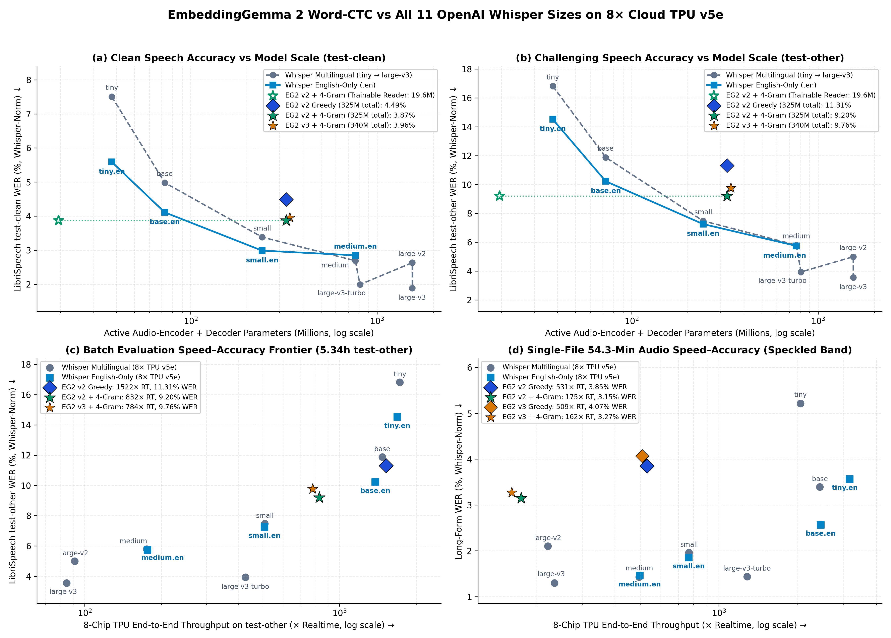
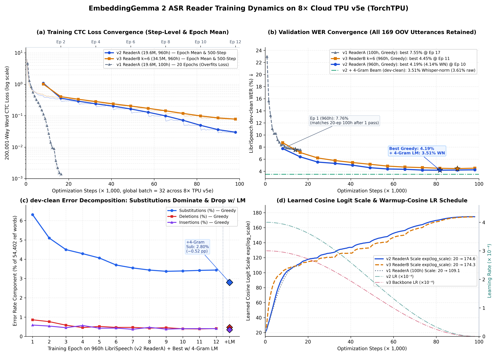
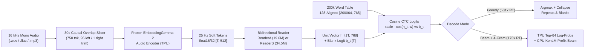

# EmbeddingGemma2-ASR-TorchTPU

Fast, lightweight open-vocabulary speech recognition built by reading **[EmbeddingGemma 2](https://huggingface.co/google/embeddinggemma-2)** (`google/embeddinggemma-2`) 25 Hz audio soft tokens directly into its 768-dimensional multimodal text embedding space and matching against a **200,000-word lexicon embedding table** via cosine-similarity CTC — trained and served natively on Google Cloud TPU v5e using **`TorchTPU`** (`torch.device("tpu")`).

Inspired by [*Embedding Gemma Transcribe* (`eg2-transcribe`)](https://x.com/googlegemma/status/2113294644222259486). With a **19.6M-parameter** reader (**3.7× smaller** than OpenAI's `whisper-base.en`) and 4-gram KenLM prefix beam search, this system achieves **`3.87%` WER on LibriSpeech `test-clean` and `9.20%` WER on `test-other`** (Whisper-normalized; **`4.01%` / `9.38%` raw**), outperforming both `whisper-base` and `whisper-base.en` while transcribing 54.3-minute continuous audio in **6.14 s (`531×` realtime)** greedy or **18.57 s (`175×` realtime, `3.15%` WER)** with beam search on an 8-chip TPU v5e pod slice (`v5litepod-8`).

---

## Key Features

- **Direct Audio-to-Embedding Word CTC (`200,001` classes)**: Emits whole English words directly at 25 Hz by computing scaled cosine similarity `scale * cos(h_t, word_table[w])` against 200,000 L2-normalized `EmbeddingGemma 2` word embeddings plus a learned CTC blank logit — no subword autoregressive decoder required.
- **Two Reader Architectures Included & Benchmarked on Full 960h LibriSpeech**:
  - **`v2` (`ReaderA`, `19.6M` params)**: 6-layer, 8-head bidirectional RoPE pre-LayerNorm Transformer trained from scratch (`3.87%` / `9.20%` `test-clean` / `test-other` WER).
  - **`v3` (`ReaderB(k=6)`, `34.5M` params)**: Initialized directly from `EmbeddingGemma 2`'s pretrained multimodal/text layers `0..5` (`ple`, 5 local layers + global `full_attention` layer 5, `norm`, `embedding_projection`), converging dramatically faster in low-data regimes (`15.59%` vs `22.99%` `dev-clean` WER after 1 epoch on 100h) and reaching `3.96%` / `9.76%` on full 960h.
- **Zero-Sync Static-Shape `TorchTPU` Engine**: 128-tile-aligned word embedding matrices (`[200064, 768]`), static chunked log-partition normalizer (`_LogSumExpCosStatic`), SPMD-identical length-bucketed DDP (`T ∈ {256, 512, 768, 1024}`), and fused 128-aligned flat ICI `all_reduce` + gradient clipping — zero dynamic shape recompiles or per-step host syncs.
- **Hybrid TPU + Multi-Core CPU 200k-Word Beam Decoder**: Extracts exact normalized top-`K` (`K=64`) word log-probabilities per frame on TPU and runs an $O(1)$ trie-memoized CTC prefix beam search with 4-gram KenLM rescoring on CPU, cutting `test-other` WER by **>2.1 percentage points** while adding only `1.3–3.2 s` per split.
- **Seamless Multi-Hour Long-Form Transcription**: Causal-overlap 30 s audio windowing (`96` left-overlap tokens + `1` right-extra token dropped) paired with overlapping bidirectional reader windows transcribes hour-long recordings with zero boundary artifacts at **`175×–531×` realtime**.

---

## Benchmark Results (`v5litepod-8`, 8× Cloud TPU v5e)



### 1. Head-to-Head vs All 11 Official OpenAI Whisper Sizes on `8×` Cloud TPU v5e

Every model below was benchmarked on the **exact same `v5litepod-8` (`8×` Cloud TPU v5e) VM** using static-shape `TorchTPU` execution (`benchmark_whisper_tpu.py` for Whisper with compiled static KV-caches and verified 11/11 exact output parity vs CPU `WhisperForConditionalGeneration.generate()`; `eval_wer.py`, `beam_decode.py`, and `transcribe.py` for `EmbeddingGemma 2`).

Cells report **Whisper `EnglishTextNormalizer` WER** (matching OpenAI's official [LibriSpeech evaluation notebook](https://colab.sandbox.google.com/github/openai/whisper/blob/master/notebooks/LibriSpeech.ipynb)) followed by **Raw Unnormalized WER** in parentheses. All out-of-vocabulary (OOV) utterances in `dev` and `test` are retained and counted against our `EmbeddingGemma 2` models.

| Model / Decoder | Active Params (Trainable) | `dev-clean` | `test-clean` | `dev-other` | `test-other` | `test-other` Speed (`8×` TPU) | 54.3-Min Long-Form WER (`8×` TPU Speed) |
| :--- | ---: | ---: | ---: | ---: | ---: | ---: | ---: |
| OpenAI `whisper-tiny` | 37.8M (—) | 7.85% (19.54%) | 7.51% (19.33%) | 16.33% (27.52%) | 16.82% (28.43%) | 11.16 s (`1,723×` RT) | 5.21% (`1.59 s`, `2,049×` RT) |
| OpenAI `whisper-tiny.en` | 37.8M (—) | 5.68% (18.08%) | 5.59% (18.20%) | 13.47% (25.34%) | 14.52% (26.86%) | 11.42 s (`1,684×` RT) | 3.56% (`1.03 s`, `3,163×` RT) |
| OpenAI `whisper-base` | 72.6M (—) | 5.64% (18.40%) | 4.98% (17.92%) | 11.41% (23.79%) | 11.88% (24.61%) | 13.07 s (`1,471×` RT) | 3.39% (`1.34 s`, `2,431×` RT) |
| OpenAI `whisper-base.en` | 72.6M (—) | 4.23% (17.10%) | 4.11% (17.12%) | 9.84% (22.57%) | 10.22% (23.18%) | 13.93 s (`1,380×` RT) | 2.57% (`1.33 s`, `2,449×` RT) |
| OpenAI `whisper-small` | 241.7M (—) | 3.43% (16.81%) | 3.38% (16.69%) | 7.29% (20.76%) | 7.48% (21.42%) | 37.80 s (`509×` RT) | 1.96% (`4.24 s`, `768×` RT) |
| OpenAI `whisper-small.en` | 241.7M (—) | 3.09% (16.76%) | 2.99% (16.68%) | 6.69% (20.46%) | 7.26% (21.30%) | 37.91 s (`507×` RT) | 1.85% (`4.25 s`, `767×` RT) |
| OpenAI `whisper-medium` | 763.9M (—) | 2.50% (16.37%) | 2.69% (16.54%) | 5.41% (19.49%) | 5.80% (20.14%) | 109.85 s (`175×` RT) | 1.43% (`6.57 s`, `496×` RT) |
| OpenAI `whisper-medium.en` | 763.9M (—) | 2.57% (16.43%) | 2.85% (16.95%) | 5.65% (19.74%) | 5.74% (20.25%) | 109.03 s (`176×` RT) | 1.46% (`6.54 s`, `498×` RT) |
| OpenAI `whisper-large-v3-turbo` | 808.9M (—) | 1.91% (10.94%) | 1.99% (10.74%) | 3.84% (11.82%) | 3.94% (11.37%) | 45.03 s (`427×` RT) | 1.44% (`2.54 s`, `1,283×` RT) |
| OpenAI `whisper-large-v2` | 1,543.3M (—) | 2.27% (16.32%) | 2.63% (16.75%) | 4.81% (19.30%) | 4.99% (19.55%) | 210.60 s (`91×` RT) | 2.10% (`14.69 s`, `222×` RT) |
| OpenAI `whisper-large-v3` | 1,543.5M (—) | **1.79%** (11.28%) | **1.89%** (11.15%) | **3.57%** (13.17%) | **3.56%** (12.81%) | 226.16 s (`85×` RT) | **1.30%** (`13.84 s`, `235×` RT) |
| `EG2 v1` `ReaderA` (100h, Greedy) | 325.2M (**19.6M**) | 7.60% (7.55%) | 7.67% (7.65%) | 16.18% (16.13%) | 16.40% (16.33%) | ~12.8 s† (`1,500×` RT) | 6.23% (`6.38 s`, `511×` RT) |
| **`EG2 v3` `ReaderB(k=6)` (960h, Greedy)** | 340.1M (**34.5M**) | 4.45% (4.45%) | 4.90% (4.92%) | 11.87% (11.82%) | 11.88% (11.90%) | ~13.2 s† (`1,462×` RT) | 4.07% (`6.40 s`, `509×` RT) |
| **`EG2 v2` `ReaderA` (960h, Greedy)** | 325.2M (**19.6M**) | 4.14% (4.19%) | 4.49% (4.54%) | 11.28% (11.28%) | 11.31% (11.37%) | ~12.6 s† (`1,522×` RT) | 3.85% (`6.14 s`, `531×` RT) |
| **`EG2 v3` `ReaderB(k=6)` (960h + 4-Gram)** | 340.1M (**34.5M**) | 3.68% (3.76%) | **3.96%** (4.07%) | 9.47% (9.56%) | **9.76%** (9.89%) | ~24.5 s† (`784×` RT) | 3.27% (`20.15 s`, `162×` RT) |
| **`EG2 v2` `ReaderA` (960h + 4-Gram)** | 325.2M (**19.6M**) | **3.51%** (3.61%) | **3.87%** (4.01%) | **9.14%** (9.26%) | **9.20%** (9.38%) | ~23.1 s† (`832×` RT) | **3.15%** (`18.57 s`, `175×` RT) |

> [!NOTE]
> - **Active vs Trainable Params**: `EmbeddingGemma 2`'s frozen audio encoder (`audio_tower` + `embed_audio` projection) has `305.6M` parameters; only the `19.6M` (`ReaderA`) or `34.5M` (`ReaderB(k=6)`) reader is trained, matched against a static `200,000 × 768` `float16` word embedding table.
> - **† End-to-End Split Timing**: On `test-other` (`5.34 h`), `EG2` reader decoding takes `6.47 s` (Greedy) or `16.94 s` (Beam + 4-Gram) from cached soft tokens; adding `~6.16 s` (`3,120×` RT) for raw-audio soft-token extraction yields `~12.6 s` (`1,522×` RT) and `~23.1 s` (`832×` RT) end-to-end. Whisper raw WERs (~11–28% on LibriSpeech) reflect Whisper's punctuated/capitalized orthography prior to `EnglishTextNormalizer`, matching OpenAI's official LibriSpeech notebook.
> - Full per-epoch histories, error breakdowns (`S / D / I`), top-20 substitution pairs, and Whisper TPU benchmark JSONs are committed under [`results/`](results/).

### 2. Training Curves (`v1` 100h, `v2` `ReaderA` 960h, `v3` `ReaderB(k=6)` 960h)



### 3. Single-Chip vs 8-Chip Long-Form Continuous Audio Breakdown (54.29-Min *Speckled Band*)

| Model / Decoder | Devices (`TorchTPU`) | Encode (s) | Decode (s) | Total (s) | Speed (`×` Realtime) | Whisper-Norm WER | Raw WER |
| :--- | :--- | ---: | ---: | ---: | ---: | ---: | ---: |
| `v2` `ReaderA` (Greedy) | `1×` TPU v5e | 10.43 s | 5.54 s | 15.97 s | **204.0×** | 3.85% | 4.44% |
| `v2` `ReaderA` (Greedy) | `8×` TPU v5e | 1.62 s | 4.52 s | **6.14 s** | **530.9×** | 3.85% | 4.44% |
| `v3` `ReaderB(k=6)` (Greedy) | `1×` TPU v5e | 9.57 s | 4.97 s | 14.54 s | **224.0×** | 4.07% | 4.60% |
| `v3` `ReaderB(k=6)` (Greedy) | `8×` TPU v5e | 1.62 s | 4.78 s | 6.40 s | **508.7×** | 4.07% | 4.60% |
| **`v3` `ReaderB(k=6)` (Beam + 4-Gram)** | `8×` TPU v5e | 1.63 s | 18.53 s | 20.15 s | **161.6×** | **3.27%** | **3.80%** |
| **`v2` `ReaderA` (Beam + 4-Gram)** | `8×` TPU v5e | 1.62 s | 16.95 s | 18.57 s | **175.4×** | **3.15%** | **3.68%** |

### 4. Training & Preprocessing Throughput (`8×` TPU v5e)

- **200,000-Word Lexicon Table Encoding (`make_table.py`)**: `200,000` words encoded in **4.0 s** (`49,731` words/s) in `Precision.HIGHEST`, `1.000` top-1 self-retrieval, TPU vs CPU `min_cos = 0.9999999`.
- **Audio Soft-Token Caching (`cache_soft_tokens.py`)**: `train-clean-360` (`363.6 h`) cached in **416.2 s (`3,145×` realtime)**; `train-other-500` (`496.9 h`) cached in **578.1 s (`3,094×` realtime)**; TPU vs CPU single-utterance `float32` parity `min_token_cos = 0.9999995`.
- **960h Reader Training (`train.py`, `8,172` steps/epoch, global batch `32`)**:
  - `v2` `ReaderA` (`19.6M` params, eager `TorchTPU`): `~53,000` soft tokens/s (`25.4 min/epoch`).
  - `v3` `ReaderB(k=6)` (`34.5M` params, `torch.compile(backend="tpu")`): `~75,000` soft tokens/s (`18.5 min/epoch`, **3.70 hours** total for 12 epochs).

---

## Tech Stack

- **Language**: Python 3.11+
- **Accelerator Runtime**: PyTorch + **`TorchTPU`** (`torch.device("tpu")`, `tpu_dist` ICI backend, XLA Tier-2/Tier-3 persistent compilation caches; automatic fallback to CUDA / Apple MPS / CPU)
- **Foundation Model**: [`google/embeddinggemma-2`](https://huggingface.co/google/embeddinggemma-2) (`Gemma4AudioFeatureExtractor` + `EmbeddingGemma2Model` via Hugging Face `transformers` & `sentence-transformers`)
- **Language Model Rescoring**: [`kenlm`](https://github.com/kpu/kenlm) with the OpenSLR SLR11 LibriSpeech 4-gram ARPA/binary trie
- **Audio & Evaluation**: `soundfile`, `soxr` / `ffmpeg`, `pyarrow`, `jiwer`, Whisper `EnglishTextNormalizer`

---

## Prerequisites

1. **Hardware**:
   - **Recommended**: A Google Cloud TPU VM (e.g., `v5litepod-8` with 8× TPU v5e chips) and an attached **1 TB SSD (`pd-ssd`)** mounted at `~/data` (`~62 GB` LibriSpeech parquet shards + `~84 GB` cached `float16` soft tokens + `~4 GB` model & KenLM files).
   - **CPU / CUDA / MPS**: Supported out-of-the-box (`--device auto`) for inference, development, and mathematical self-tests.
2. **Software**:
   - Python 3.11+ or Conda environment with `torch` (and `torch_tpu` + `libtpu` on Cloud TPU VMs)
   - `ffmpeg` (optional, for `.mp3` decoding if `soundfile` lacks MP3 support)
   - `build_binary` from `kenlm` (optional; compiles `4-gram.arpa.gz` into a fast memory-mapped `4-gram.bin` trie, though `kenlm.Model` can also load `4-gram.arpa.gz` directly)
   - Access to [`google/embeddinggemma-2`](https://huggingface.co/google/embeddinggemma-2) on Hugging Face (`huggingface-cli login` if gated)

---

## Getting Started

### 1. Clone the Repository

```bash
git clone https://github.com/windmaple/EmbeddingGemma2-ASR-TorchTPU.git
cd EmbeddingGemma2-ASR-TorchTPU
```

### 2. Install Dependencies

Activate your `TorchTPU` (or PyTorch) environment and install the required packages:

```bash
conda activate TorchTPU  # or your Python 3.11+ virtualenv
pip install -r requirements.txt
```

*(Optional)* To compile OpenSLR's `4-gram.arpa.gz` into a fast `1.5 GB` binary trie (`4-gram.bin`), install KenLM's CLI utilities (`sudo apt-get install -y build-essential cmake libboost-all-dev zlib1g-dev libbz2-dev liblzma-dev` and build `kenlm`'s `build_binary` onto your `PATH`).

### 3. Option A — Run the Full End-to-End 960h Pipeline

Ensure `~/data` points to a disk with at least `200 GB` of free space (override via `export DATA=/path/to/disk`), then run:

```bash
# Train & evaluate v2 (ReaderA, 19.6M params — best overall WER: 3.87% / 9.20%)
./run_full_pipeline.sh

# (Optional) Train & evaluate v3 (ReaderB(k=6), 34.5M pretrained EmbeddingGemma 2 layers 0..5)
./run_v3_pipeline.sh
```

`run_full_pipeline.sh` executes all 6 stages automatically:
1. Downloads `google/embeddinggemma-2`, all 7 LibriSpeech parquet splits (`130` shards, `961.6 h`), the 200k-word pronunciation lexicon, the 54.3-minute *Speckled Band* benchmark, and the OpenSLR 4-gram LM (`download_assets.py`).
2. Encodes all `200,000` lexicon words into `vocab.txt` + `word_table.npy` across 8 TPU chips (`make_table.py`).
3. Extracts and caches 25 Hz `EmbeddingGemma 2` audio soft tokens (`float16 [T, 512]`) for all 7 splits (`cache_soft_tokens.py`).
4. Trains `ReaderA` for 12 epochs on `960h` LibriSpeech across 8 TPU chips (`train.py`).
5. Exports `reader.pt` + `reader_config.json` and evaluates both Greedy (`eval_wer.py`) and 4-Gram Beam Search (`beam_decode.py`) across `dev-clean`, `dev-other`, `test-clean`, and `test-other`.
6. Benchmarks single-chip and 8-chip short & 54.3-minute long-form transcription (`transcribe.py`).

### 4. Option B — Transcribe Any Audio File (`.wav`, `.flac`, `.mp3`)

Once `reader.pt`, `reader_config.json`, `vocab.txt`, and `word_table.npy` are in `--reader-dir`:

**Single TPU chip (or GPU/CPU), greedy decoding:**
```bash
python transcribe.py /path/to/audio.wav \
  --reader-dir . \
  --model-dir ~/data/embeddinggemma-2
```

**All 8 TPU v5e chips + 4-Gram KenLM prefix beam search (`175×` realtime, highest accuracy):**
```bash
eval "$(python -m torch.tpu.distributed | sed 's/^/export /')"
export TORCH_TPU_DEVICES_PER_HOST=8
torchrun --nproc_per_node="$WORLD_SIZE" transcribe.py \
  ~/data/speckled_band/audio_16k.wav \
  --reader-dir . \
  --model-dir ~/data/embeddinggemma-2 \
  --lm ~/data/lm/4-gram.bin \
  --reference ~/data/speckled_band/transcript.txt \
  --out-json transcription_report.json
```

---

## Architecture

### End-to-End Data Flow



### Directory Structure

```text
EmbeddingGemma2-ASR-TorchTPU/
├── model.py              # ReaderA, ReaderB (pretrained EG2 layers 0..k-1), ReaderC,
│                         # 128-aligned PreparedTable, _LogSumExpCosStatic, _GatheredCTC, self-tests
├── train.py              # 8-chip TorchTPU SPMD-bucketed DDP trainer + sharded dev WER eval
├── decode.py             # Static-shape greedy 200k-word CTC decoder on TPU/GPU/CPU
├── beam_decode.py        # Hybrid TPU top-K + multi-core CPU 4-gram KenLM CTC prefix beam decoder
├── transcribe.py         # Arbitrary-length (.wav/.flac/.mp3) causal-overlap audio transcriber
├── cache_soft_tokens.py  # 8-chip static-bucket EmbeddingGemma 2 soft-token extractor (3,100x RT)
├── make_table.py         # 8-chip static-shape 200,000-word EmbeddingGemma 2 lexicon encoder
├── data.py               # Cached split loader, OOV/CTC-feasibility filter, SPMD bucket batcher
├── eval_wer.py           # Checkpoint exporter, 4-split greedy WER, Whisper normalizer & homophones
├── download_assets.py    # Downloader for EmbeddingGemma 2, LibriSpeech 960h, lexicon & 4-gram LM
├── tpu_utils.py          # TorchTPU device detection, XLA cache config, HF zero-sync runtime patches
├── run_full_pipeline.sh      # End-to-end 6-stage reproduction script for v2 (ReaderA, 960h)
├── run_v3_pipeline.sh        # End-to-end 4-stage reproduction script for v3 (ReaderB k=6, 960h)
├── benchmark_whisper_tpu.py  # Compiled static KV-cache TorchTPU benchmark for all 11 OpenAI Whisper sizes
├── run_whisper_benchmark.sh  # 2-stage checkpoint pre-cacher + 8-chip Whisper benchmark launcher
├── plot_curves.py            # Generates high-DPI training_curves.png and whisper_comparison.png
├── assets/                   # Embedded training curve & Whisper comparison figures
├── results/
│   ├── whisper_tpu_benchmark.json  # Full 11-model OpenAI Whisper TorchTPU WER & throughput report
│   ├── v1/                   # ReaderA (100h) step logs, epoch history, and WER JSONs
│   ├── v2/                   # ReaderA (960h, 19.6M) step logs, configs, greedy & 4-gram WER JSONs
│   └── v3/                   # ReaderB (960h, 34.5M) step logs, configs, greedy & 4-gram WER JSONs
├── requirements.txt          # Python package dependencies
└── LICENSE                   # Apache-2.0 License
```

### Key Technical Components

1. **Exact 200,001-Way Cosine-Similarity CTC Without Host Syncs (`model.py`)**:
   - Materializing a dense `[B, T, 200001]` float32 tensor and its gradient on every step wastes HBM bandwidth, while dynamic boolean indexing (`h[valid]`) triggers `aten::nonzero` device-to-host syncs on XLA/TPU.
   - `PreparedTable` pads the `200,000 × 768` word embedding matrix to `200,064 × 768` (`128`-tile aligned for TPU MXU) with `-1e9` column masking on padded indices.
   - `_LogSumExpCosStatic` streams all `B × T` bucketed frames in fixed `1,024`-row chunks on the TPU MXU to compute the exact 200,000-word log-partition function `lse_words` and its analytical backward pass without storing full logits.
   - Unique target words per utterance are gathered into a static `128`-aligned `[B, T, C_bucket]` tensor, normalized against `logsumexp([lse_words, blank])`, and scored via `_GatheredCTC`, matching dense `torch.nn.functional.ctc_loss` to `< 1e-9` in `float64`.

2. **SPMD-Identical Static Bucketing & Flat ICI All-Reduce (`data.py`, `train.py`)**:
   - In multi-process `TorchTPU` DDP (`tpu_dist`), if rank 0 gets a batch padded to `T=512` while rank 1 gets `T=768`, XLA collectives deadlock or recompile. `bucket_batches_ddp` forms global length-jittered batches first, picks a single `T_bucket ∈ {256, 512, 768, 1024}` shared by all ranks, and interleaves utterances `rank::world_size`.
   - `all_reduce_and_clip_grads_flat` packs all parameter gradients into a single 128-aligned contiguous buffer, performs one ICI `dist.all_reduce(SUM)` across all 8 chips, and applies global L2 norm clipping completely on device.

3. **`ReaderA` vs Pretrained `ReaderB(k=6)` (`model.py`)**:
   - **`ReaderA` (`19,573,762` params)**: Dedicated 6-layer pre-LayerNorm bidirectional RoPE Transformer (`d=512`, **8 attention heads**, `head_dim=64`, `FFN=2048` GELU) with `Linear(512 -> 768)` output projection.
   - **`ReaderB(k=6)` (`34,492,674` params)**: Slices layers `0..5` from `EmbeddingGemma 2`'s text encoder (`5` local layers with `4` query / `2` KV heads, `head_dim=256`, `rope=10,000`, followed by `layer 5` global `full_attention` with `4` query / `1` KV head, `head_dim=512`, `rope=1,000,000`), including Per-Layer Embeddings (`ple`) and pretrained `embedding_projection` (`512 -> 768`), converted to full bidirectional attention.
   - **Empirical Finding**: Pretrained `ReaderB(k=6)` provides a strong inductive bias in low-resource/early training (`15.59%` vs `22.99%` `dev-clean` WER after 1 epoch on 100h), whereas at full 960h convergence (`98,064` steps), `ReaderA`'s 8-head clean residual architecture edges out `ReaderB(k=6)` (`3.87%` vs `3.96%` `test-clean`, `9.20%` vs `9.76%` `test-other`).

4. **Hugging Face Zero-Sync Runtime Patches for TPU (`tpu_utils.py`)**:
   - Patches `transformers.masking_utils._ignore_causal_mask_sdpa` to avoid data-dependent boolean syncs on `tpu` tensors, teaches `sentence_transformers` to recognize `torch.device("tpu")`, and allows loading text/audio `EmbeddingGemma 2` without requiring `torchvision`.

---

## Environment Variables

| Variable | Description | Default |
| :--- | :--- | :--- |
| `DATA` / `DATA_DIR` | Root directory for datasets, soft-token caches, checkpoints, and KenLM | `~/data` |
| `BIN` | Directory containing `python` and `torchrun` in shell pipelines | `~/miniconda3/envs/TorchTPU/bin` (if present) or `PATH` |
| `TORCH_TPU_DEVICES_PER_HOST` | Number of TPU chips used per host in distributed runs | `8` |
| `TORCH_TPU_TIER2_COMPILATION_CACHE` | Enables in-memory XLA graph cache in `TorchTPU` | `1` |
| `TORCH_TPU_TIER3_COMPILATION_CACHE_ROOT` | Persistent on-disk XLA compilation cache directory | `~/data/torchtpu_cache` |
| `HF_HOME` | Hugging Face cache directory | `~/data/hf_cache` |
| `TMPDIR` | Scratch directory for distributed shard exchange | `~/data/tmp` |

---

## Available Scripts

| Command | Description |
| :--- | :--- |
| `python download_assets.py --data-dir ~/data` | Download `EmbeddingGemma 2`, LibriSpeech 960h, lexicon, benchmark audio, and 4-gram LM |
| `torchrun --nproc_per_node=8 make_table.py ...` | Encode all 200,000 lexicon words into `vocab.txt` + `word_table.npy` |
| `torchrun --nproc_per_node=8 cache_soft_tokens.py ...` | Extract & cache 25 Hz audio soft tokens (`float16 [T, 512]`) across splits |
| `python data.py --cache ~/data/soft_tokens_cache --vocab vocab.txt` | Inspect split durations, OOV counts, and CTC feasibility |
| `torchrun --nproc_per_node=8 train.py --arch a ...` | Train `ReaderA` (`--arch a`), `ReaderB` (`--arch b --k 6 --compile`), or `ReaderC` (`--arch c`) |
| `torchrun --nproc_per_node=8 eval_wer.py ...` | Export best checkpoint and compute greedy raw + Whisper-norm WER & homophone stats |
| `torchrun --nproc_per_node=8 beam_decode.py ...` | Run 200k-word CTC prefix beam search + 4-gram KenLM rescoring (with optional `--tune-dev`) |
| `python transcribe.py <audio> [--lm 4-gram.bin]` | Transcribe short or multi-hour `.wav`/`.flac`/`.mp3` files on 1 or 8 chips |
| `./run_whisper_benchmark.sh` | Benchmark all 11 OpenAI Whisper sizes across LibriSpeech & long-form audio on 8× TPU |
| `python plot_curves.py` | Regenerate `assets/training_curves.png` and `assets/whisper_comparison.png` from `results/` |
| `python model.py --self-test --device tpu` | Verify exact value & gradient parity between static gathered CTC and dense `F.ctc_loss` |

---

## Testing & Verification

Run the built-in mathematical and accelerator self-test suite on CPU (`float64`, tolerance `1e-9`) and TPU (`float32`, tolerance `1e-4`):

```bash
# CPU float64 exact gradient & loss verification (no TPU required)
python model.py --self-test --device cpu

# CPU float64 + end-to-end TPU float32 ReaderA forward/backward/step/decode check
python model.py --self-test --device tpu
```

Expected output:
```text
[cpu torch.float64] loss gathered=10.45783728 full=10.45783728; max|d|={'loss': 0.0, 'grad_v': 1.05e-17, 'grad_blank': 1.13e-15, 'grad_scale': 6.25e-17}; infeasible=1 -> PASS
[tpu torch.float32] loss gathered=10.41317940 full=10.41316795; max|d|={'loss': 1.14e-05, 'grad_v': 7.97e-09, 'grad_blank': 7.82e-07, 'grad_scale': 6.71e-08}; infeasible=1 -> PASS
[tpu ReaderA e2e] loss=5.6856 grad_norm=12.0208 labels_shape=(4, 32) -> PASS
arch a (6 layers): 19,573,762 parameters
arch b: 22,427,394 parameters
arch c: 1,314,306 parameters
```

---

## Troubleshooting

### 1. `TorchTPU` `/dev/vfio/0` Device Busy Error
**Symptom**: `RuntimeError` or PJRT initialization failure mentioning `/dev/vfio` when launching a second Python process.
**Cause**: Only one process group can hold the TPU VFIO devices at a time, and calling global `torch.manual_seed(...)` in `TorchTPU` initializes the TPU backend even for CPU tensors.
**Fix**: Ensure no stale `torchrun` / `python` process holds `/dev/vfio/*` (`fuser -v /dev/vfio/*`), and always launch multi-chip jobs via `eval "$(python -m torch.tpu.distributed | sed 's/^/export /')"` before `torchrun`.

### 2. Severe Step Slowdown When Scaling `ReaderB` to `k >= 12`
**Symptom**: `ReaderB(k=6)` runs at `~130 ms/step` (`75k tok/s`) with `--compile`, whereas `ReaderB(k=12)` drops to `>3,200 ms/step`.
**Cause**: Layers `5, 11, ...` use `head_dim=512` (`4` heads = `2048` projection width) plus Per-Layer Embedding (`ple`) activations; stacking 12+ layers across `[B_local=4, T=1024]` exceeds per-chip v5e HBM activation budget during backprop, triggering HBM spills/rematerialization.
**Fix**: Stick to `k=6` (one complete `EmbeddingGemma 2` local+global 6-layer block `0..5`) with `--compile`, or reduce per-chip `local_batch_size` to `2` (`--batch-size 16` across 8 chips).

### 3. `ImportError: Torchvision not found` When Loading `SentenceTransformer`
**Cause**: `EmbeddingGemma 2`'s processor config references multimodal image/video processors even when only text/audio encoders are used.
**Fix**: Always call `patch_hf_for_tpu()` from `tpu_utils.py` before instantiating `SentenceTransformer` (already wired into `make_table.py`, `cache_soft_tokens.py`, and `transcribe.py`).

---

## License & Acknowledgments

- Code in this repository is licensed under the [Apache License 2.0](LICENSE).
- Built upon Google's [**EmbeddingGemma 2**](https://huggingface.co/google/embeddinggemma-2) (subject to the Gemma Terms of Use), the [OpenSLR LibriSpeech ASR corpus & 4-gram LM](https://www.openslr.org/12), and the audio-to-word-embedding CTC paradigm introduced in [`eg2-transcribe`](https://x.com/googlegemma/status/2113294644222259486).
